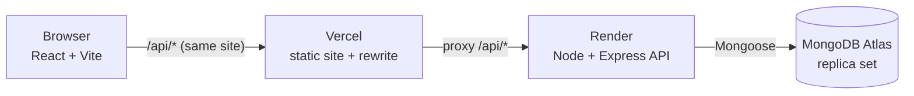
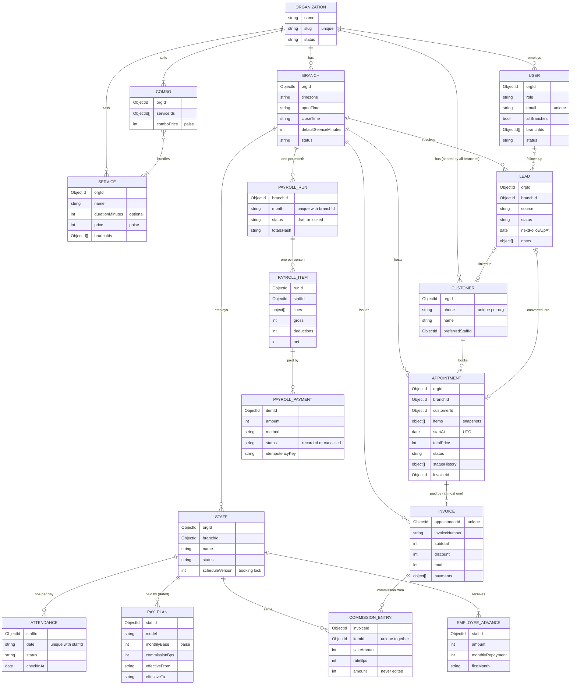
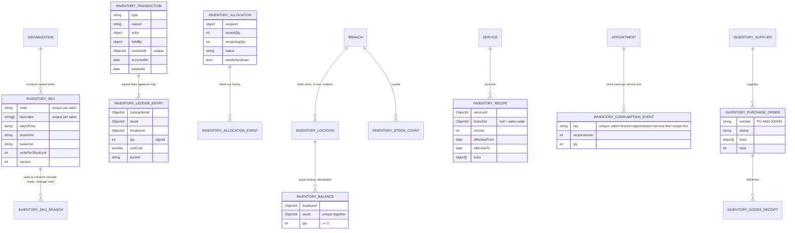

# GrowwPilot

**A multi-tenant salon management and CRM SaaS**, built with MongoDB, Express, React and Node (MERN).

GrowwPilot runs many salons on one platform. Each salon (an *organization*) has one or more branches, its own staff, services, customers, leads, bookings and payments, and it can never see another salon's data.

- **Live demo:** growwpilot.vercel.app
- **Demo accounts:** the login page has a clickable "Demo accounts" list. Every account uses the password `Password@123`.

| Role | Email | What to try |
|---|---|---|
| Super Admin | `admin@growwpilot.com` | Onboard a salon, deactivate one, switch the Inventory add-on on or off |
| Owner, all branches | `owner@glamour.com` | Dashboard, analytics + PDF, team, catalogue, Inventory (approve a write-off, review an order) |
| Owner, one branch | `bandra.owner@glamour.com` | Same screens, limited to the Bandra branch |
| Front desk | `desk.andheri@glamour.com` | Day board, booking, checkout, leads, attendance |
| Front desk | `desk.bandra@glamour.com` | The Bandra branch |
| Inventory login | `inventory.andheri@glamour.com` | Inventory only, at Andheri: issue, finish & replace, deliveries, stock count |
| Owner, another salon | `owner@desertrose.com` | A second salon in Dubai (different timezone) |
| Front desk, another salon | `desk@desertrose.com` | |

## Contents

1. [What it does](#1-what-it-does)
2. [Architecture](#2-architecture)
3. [Data model (ER diagram)](#3-data-model-er-diagram)
4. [Run it locally](#4-run-it-locally)
5. [Tests](#5-tests)
6. [Deployment](#6-deployment)
7. [Tenant isolation smoke test](#7-tenant-isolation-smoke-test)

More detail on each area: [core design](IMPLEMENTATION_PLAN.md), [billing](BILLING_PLAN.md), [payroll](PAYROLL_PLAN.md), [inventory](INVENTORY_PLAN.md), [offers](OCCASION_OFFERS_PLAN.md), [email](EMAIL_PLAN.md).

---

## 1. What it does

| Who | Logs in? | Main screens |
|---|---|---|
| **Super Admin** (GrowwPilot team) | Yes | Salon list; onboarding (salon + first branch + owner login in one step); activate or deactivate a salon; switch paid add-ons on or off |
| **Owner** | Yes | **Dashboard**, **Analytics** (demand charts + sales PDF), **Billing** (approvals, voids, settings and reports), **Payroll**, branches, team, services and combos, plus everything the front desk sees |
| **Front desk** | Yes | **Day board**, booking, appointment list, customers, leads, **checkout and bills**, **cash drawer**, dues, attendance, **Staff pay**. Works in **one branch only**. |
| **Inventory login** (add-on) | Yes | **Inventory only**, for one branch |
| **Staff** (stylists) | No | A record: booked on appointments, attendance marked by the front desk, paid through payroll |
| **Front desk member** | Their front desk login, if linked | A team member of type *Front desk*: never booked, paid a salary, per day or per hour |
| **Customer** | No | A record: created by the front desk or by converting a lead |

There are **two kinds of owner**: the **primary owner** (shown as **Business owner**) sees and manages every branch, and a **branch owner** only sees the branches the primary owner gives them.

**Dashboard.** For the selected branch: **Salon Pulse** (net sales vs a usual same weekday, chairs filled), today's net sales, appointments and open leads, and a **Requires attention** list with a one-click action per row (customers waiting or not showing up, visits not billed, bookings whose stylist is away, overdue lead follow-ups).

**Analytics.** Branch demand, the busiest times (weekday × hour), stylist demand and top services for a date range, with a timestamped **sales PDF**.

**Bell.** It only shows things that need you: a request to approve (discount, refund, write-off, order, stock count, pay change, problem report), the answer to your own request, or something that failed and needs a person (a service that couldn't take its stock, a stylist who left with stock, an offer email not sent). Everything else is in the activity log.

**Payroll.** Uses the existing roles and branch access.

| | Business owner | Branch owner | Front desk |
|---|---|---|---|
| Pay setup (how each person is paid) | Every branch | Their branches | See only, at their branch; **request** a change for an owner to approve |
| Commission, monthly payroll, lock the month | Every branch | Their branches | No |
| Salary payments, payslips, advances | Every branch | Their branches | No |
| Front desk members' pay | Every branch | Their branches | No, not even their own |
| Activity log | Every branch | Their branches | No |

- **7 ways to pay:** fixed monthly, monthly + commission, commission only, per day, per hour, per service, or a mix. A change starts on a date and never rewrites past pay.
- **Commission** is earned when a service is completed **and paid**, on what the customer actually paid; a special rate per service beats the person's normal %.
- **Monthly payroll** per branch: worked out from pay setups, attendance and commission, with a "things to check" list, bonuses and deductions, and **Lock month**. A locked month never changes.
- **Payments** (full or part) only against locked months, **payslip PDFs**, and **advances** taken back monthly.

**Billing, POS & Payments.**

- **Bills:** checkout opens a **draft**; **Issue & Pay** gives it its number (`AND/26-27/00001`, per branch and financial year) and locks it.
- **GST** (optional per salon): GSTIN per branch, prices with or without GST, a rate per service and product, CGST + SGST per line. **Not GST registered** salons get plain bills.
- **GST setup** (**GST → Settings**, business owner): dated GST registrations with each branch linked to one GSTIN per date, owner-approved tax rules that can't be edited (a new rate is a new dated row, starting from 5% without ITC), test bills, then **Activate**. After that, each bill takes its rate and code from the rule for its date, a line with no approved rule can't be issued, a business customer's GSTIN prints on the bill, and a place of supply in another state gives **IGST** on the bill, tax table, PDF, credit note and GST report. Salons that haven't activated bill as before.
- **Tax record and GST menu:** each bill on an activated salon gets a permanent entry saved in the same transaction, so one can't exist without the other. A retry can't add a second. Credit notes and voids add linked minus entries; the original never changes. Older GST bills from the start month on are added once. **GST → Overview** shows a month's output tax and what needs attention, **Sales & Returns** lists every entry with a link to its bill and a CSV, and the **GST collected** report reads the same record. Each night the app compares bills with the record, lists differences and rings the business owner's bell only for a new one. Branch owners see this for their own branches if switched on.
- **Advances for named services:** once GST setup is active, an advance can be taken for named services. Its tax is worked out from their approved rule when the money comes in, with a numbered receipt voucher and PDF. Using it on a later bill uses up the tax already paid, so the same money is never taxed twice, and the tax used can never exceed the tax paid. A taxed advance only pays bills under its own GSTIN and place of supply. Unused money can be given back (any advance), with a numbered refund voucher and a linked minus entry on taxed ones. Plain advances and extra money kept at checkout stay untaxed. **GST → Advances** shows taken, used and left, with tax, for each GSTIN.
- **GSTR-1:** **GST → Returns** prepares a GSTIN's month from the tax record: B2B, B2C large and others, credit notes, advances (Table 11), HSN/SAC for B2B and B2C (Table 12) and documents (Table 13). Every figure opens its entries, and each entry is in a table or listed as left out, exactly once. Errors link to the bill, service or product; rebuilding makes a new revision and keeps the old one. An approved revision can't change. It downloads as a JSON file, with a review CSV and PDF. Exported never means Filed: filing is recorded by hand with the ARN and proof, shown as manually confirmed, and the month locks. Corrections go through GSTR-1A before GSTR-3B is filed, and to review after. **The file's layout comes from public notes on the GST offline tool, because GSTN doesn't publish it openly, and it has not yet been uploaded to the portal.**
- **Purchases, ITC and GSTR-3B:** **GST → Purchases & ITC** holds supplier bills (with or without the Inventory add-on) and imported GSTR-2B files, recognising the same file twice. Each row is Matched, Missing in 2B, Missing in books, Amount mismatch, Duplicate or Needs review. A match alone never claims credit: the owner decides with a reason, and each decision is kept. The **GSTR-3B working sheet** places output tax and approved credit in the 3.1, 3.2 and Table 4 rows, with the portal's figures and the differences beside them. Unresolved purchases block approval. The owner pays and files on the portal, then records the ARN and proof, which locks the month. The app never says the tax was paid, and has no interest, late fees or ledger balances. **The GSTR-2B file layout is also from public notes, so it is read tolerantly and a simple CSV is the fallback.**
- **Part refunds by amount:** ₹525 off a ₹1,050 haircut takes back ₹500 taxable and ₹25 tax, never more than is left on the line. Commission comes back in the same share.
- **Discounts** per line or on the whole bill. The front desk has a limit (10%); above it an owner approves. Only owners change a price.
- **Payments:** split (Cash, UPI, Card, Other), part payments and pay later. Never recorded twice, never more than the bill. Owners can reverse a wrong payment.
- **Products** (with the Inventory add-on): add retail products at checkout or make a **New sale**.
- **Refunds and returns:** the front desk asks, an owner approves. Money back, a **credit note** on GST bills, sellable products back on the shelf, commission taken back. Owners can **void** a bill with no money on it.
- **Customer advances:** taken on the profile, used at checkout at any branch.
- **Cash drawer:** open with a float, cash in and out filled in by itself, petty cash, count and close.
- **Dues** by age, a customer's **Bills & payments**, **billing reports** with CSV, bill **PDFs**, a **share link** for the customer, and each bill's **history**.

**Inventory & Procurement** (a paid add-on the Super Admin switches on per salon).

| | Business owner | Branch owner | Inventory login | Front desk |
|---|---|---|---|---|
| See stock | Every branch | Their branches | Their branch | Their branch |
| Add or edit products | Yes | Products used only at their branches | Products used only at their branch | No |
| Issue / move / return, mark finished, receive | Yes | Yes | Yes | Only what an owner switches on (finish is on by default) |
| Use / write off / adjust | Yes | Up to their limit | Up to the branch limit | **Report a problem** only |
| Purchase orders | Create and approve | Create; approve up to their limit | Create (always sent for approval) | No |
| Recipes, stock count approval, settings | Yes | Their branches | Recipes view only; count | No |
| Costs and stock value | Yes | Their branches (unless turned off) | No | No |

- **Every stock change is a movement** in a history that can't be edited. Stock can never go below zero, even when two people act at once.
- **Four ways stock is used:** whole bottles used up when marked **finished**, a set number of units **per service**, a set amount of ml or g **per service**, or recorded **by hand**.
- **Service recipes:** completing an appointment takes its stock automatically, once. If stock is short it waits in an exceptions list.
- **Purchasing:** suppliers, reorder suggestions, purchase orders with approval limits, part deliveries, returns to suppliers, and **stock counts**.
- **First-time setup guide** with a **CSV import** that shows every row before anything is saved.
- **Reports** with **CSV export**; cost columns are removed on the server for anyone who can't see costs.
- **Product photos and catalogue:** up to 4 photos per product, a **Catalogue** view, **bulk photo upload** matched by product code, and a **printable catalogue**.

**Birthday & Anniversary Offers.** The business owner switches it on in **Occasion offers**; it is off by default.

| | Business owner | Branch owner | Front desk |
|---|---|---|---|
| Switch on, consent wording, "Check now" | Yes | See only | No |
| Campaigns | All | "This branch only" campaigns of their branches; all-branches ones read-only | No |
| Emergency withdraw of unused offers | Yes | No | No |
| Customer dates, home branch, messaging permission | Yes | Yes | Yes |
| Import dates (CSV), remove occasion data | Import: all; remove: yes | Import: their branches' customers | No |
| Occasion list: send offer, record call, assign, book | Every branch | Their branches | Their branch |
| Apply an offer at checkout | Yes | Yes | Yes |
| Reports and CSV | Every branch | Their branches | Widget counts only |

- **Customer dates:** birthday and anniversary as **month + optional day, never the year**.
- **Messaging permission** per channel with the exact wording, how it was given, and a history that can't be edited. A customer without permission can still use their offer in the salon.
- **Campaigns** repeat every year: % off (with a maximum) or ₹ off, a minimum spend and the services that count. Editing a live campaign makes a **new version**; offers already given keep their terms.
- **Offers appear by themselves** from 01:00 on the 1st of each month, in each branch's time zone. One offer per customer, occasion and year.
- **Front desk occasion list:** **Send offer** (at most one offer message per customer every 7 days), **Record call**, **Assign**, **Create booking**.
- **Checkout:** the offer comes off the eligible services **before GST**, one per bill, used only when the bill is issued. A voided bill in the same month gives it back.
- **Reports:** offers issued, customers contacted, linked appointments, used offers, discounts and associated sales, with CSV.

**Email.** The app sends:

| What | Who starts it | Goes to |
|---|---|---|
| Occasion offer | Staff press **Send email**, or automatically for campaigns set to *Send automatically by email* | The customer, only if they allowed offers by email (with an unsubscribe link) |
| Bill with its PDF | **Email bill** on an issued bill | The customer's email, or one typed in |
| Password link | **Forgot password?**, or an owner's **Email a password link** | The person themselves |
| Test email | The business owner, on the **Email** page | Their own login email |

The **Email** page shows the daily limit and a test email; owners see **Recent emails** with the reason for any that weren't sent. WhatsApp and SMS are sent by staff from their own phone.

**Help assistant.** A round chat button at the bottom right. Ask *"how do I take a split payment?"* and it answers with the steps **for your role** and links to the right screen.

---

## 2. Architecture



- **Frontend (`client/`):** React 19, React Router, TanStack Query (caching, auto-refresh every 60 s on live screens), react-hook-form + Zod, Tailwind CSS, Recharts, Luxon.
- **Backend (`server/`):** Express 5, Mongoose, Zod validation, JWT in an httpOnly cookie, bcrypt, Luxon, pdfkit.
- **Database:** MongoDB Atlas. A replica set is required because bookings, checkout, onboarding and lead conversion use **transactions**.
- **Same-site cookie:** Vercel forwards `/api/*` to Render, so the browser only ever talks to one site and the login cookie is first-party (no cross-site cookie problems).

**Backend layers:** `routes → controller → service → model`

```
server/src/
  config/        env.js (checks env vars at start-up), db.js, constants.js
  middleware/    auth, tenantContext (which salon/branches), requireRole, requireAddon, idempotency, validate (Zod), errorHandler
  modules/       one folder per feature: *.routes.js, *.controller.js, *.service.js, *.schemas.js
  models/        one Mongoose model per collection
  utils/         time, money, phone, mask, scoped, csv, pdf, text, stateMachine, appointmentAlerts
  scripts/       seed.js, migrations, isolation-smoke-test.js
server/tests/    Vitest tests (in-memory MongoDB replica set)
client/src/
  api/           axios client + React Query hooks per feature
  components/    ui/ kit (Button, Input, Modal, Drawer, Table...) + shared pieces
  features/      one folder per feature
  layouts/       AdminLayout, AppLayout (role-based sidebar + branch switcher)
  routes/        router.jsx, ProtectedRoute.jsx
```

**Every request** to salon data goes through `requireAuth` (loads the user from the database, so deactivation takes effect immediately) → `tenantContext` (builds `req.ctx = { orgId, allowedBranchIds, activeBranchId }` from the user, never from the request) → `requireRole` → `validate` → the controller.

---

## 3. Data model (ER diagram)



**Inventory add-on** (collections named `inventory_*`; every row has `orgId`, branch rows also `branchId`):



Also: `inventory_settings` (front desk switches, approval limits), `inventory_approvals` (write-offs waiting, problem reports), `inventory_exceptions` (automatic uses that couldn't be posted), `inventory_outbox` ("service completed" events), `inventory_imports` (CSV previews, removed after 24 h) and `idempotency_records` (the saved answer for each `Idempotency-Key`, 7 days). Product photos are files in the GridFS bucket `inventory_images` (a 1000 px picture and a 240 px thumbnail each), listed on the product in `images`.

**Billing** (every row has `orgId` and `branchId`): `invoices` (draft → issued → void; lines with their tax snapshot; `version` for stale edits), `payments` (money in or handed back) and `payment_allocations` (which bill each payment, or advance, paid), `customer_advances`, `refunds` and `credit_notes`, `cash_sessions` and `cash_movements` (append-only), and `billing_settings` (one per salon: GST, limits, branch GSTINs and prefixes, what branch owners and the front desk may do). Bill numbers come from `counters` (`invoice:<branch>:<financial year>`).

**GST** (every row has `orgId`): `gst_registrations` (GSTIN, legal name, state, and each branch's dates) and `gst_tax_rules` (code, rate, ITC type, dates, draft or approved). Rules of the same `groupId` are one rule over time; services and products point to the group. The salon's registration type, start month and active status are in `billing_settings.gst`. `gst_tax_entries` is the permanent tax record: add-only, one row per event (`orgId`, `sourceKey` unique), with signed amounts and the month and GSTIN it counts under. `gst_checks` holds each salon's latest nightly check. `gst_returns` has one row per GSTR-1 revision (unique by salon, GSTIN, month and revision), and `gst_adjustments` holds corrections after filing. Proofs of filing are in the GridFS bucket `gst_proofs`. `gst_purchase_bills` holds supplier bills, `gst_2b_imports` each imported statement (unique by file hash), `gst_itc_decisions` add-only credit decisions, and `gst_worksheets` the GSTR-3B sheet revisions. A taxed advance keeps its tax on `customer_advances.gst`, with what is left of it, and each use on `payment_allocations.advanceTax`.

**Important indexes:** `customer (orgId, phone)` unique, `invoice.appointmentId` unique while the bill isn't void, `invoice (orgId, invoiceNumber)` unique, one open cash day per branch, one refund waiting per bill, `attendance (staffId, date)` unique. Payroll: `payPlan (staffId, effectiveFrom)`, `commissionEntry (invoiceId, itemId, type, eventKey)`, `payrollRun (branchId, month)`, `payrollItem (runId, staffId)` and `payrollPayment (orgId, idempotencyKey)` are all unique, so nothing is counted or paid twice.

---

## 4. Run it locally

You need **Node 20+** and a free **MongoDB Atlas** cluster (transactions need a replica set, which Atlas is).

```bash
# 1. API  ->  http://localhost:5000 (or the PORT in .env)
cd server
cp .env.example .env    # add your Atlas URI (keep /growwpilot in it) and a JWT secret
npm install
npm run seed            # wipes the database and loads the demo data below
npm run dev

# 2. Web app  ->  http://localhost:5199
cd client
cp .env.example .env    # API_PROXY_TARGET = the API URL above
npm install
npm run dev
```

**Demo data** (`npm run seed`): 2 salons, 3 branches (Mumbai and Dubai timezones), 6 staff, 7 services, 1 combo, 10 customers, 6 leads, 43 appointments, 35 bills and 20 attendance records. **Today's appointments are placed around the current time**, so the day board and dashboard always show something happening. Also: pay setups, a locked payroll month, a pay request waiting, an advance; Glamour Studio is GST registered with the Inventory add-on (5 products at Andheri, an order, a write-off waiting for approval, a problem report; Bandra shows the setup guide) and has offers switched on; a part-paid bill, a refund and a return waiting, closed cash days and a few sample emails. Desert Rose stays plain: no GST, no add-on, no pay setups. Seed during opening hours for the best picture. The seed refuses to run when `NODE_ENV=production` unless you pass `-- --force`.

---

## 5. Tests

```bash
cd server
npm test                  # 1020 Vitest tests, on a temporary in-memory MongoDB replica set (never your real data)
npm run smoke:isolation   # tenant isolation check against a running API with the demo seed (see section 7)
```

The tests cover the parts where a bug would cost money or trust:

- **Booking engine:** overlaps, back-to-back bookings, **simultaneous bookings where exactly one wins**, opening hours, unavailable stylists, another salon's ids, timezones.
- **State machines:** every allowed and blocked appointment and lead status change.
- **Lead conversion:** links to an existing customer by phone; a clash rolls everything back.
- **Billing:** GST and rounding, discount approval, guest sales, refunds, voids, cash closing, reports that reconcile, the old-bill migration, and an API test that logs in as each role and tries **every billing action**.
- **GST setup:** the 16-character number limit, GSTIN and state checks, overlapping branch links and rule dates, approved rules that can't change, activation checks, the tax on haircut and product bills, IGST, rate changes that leave old bills alone, blocked bills, and role and salon access. Salons that haven't activated are shown to bill as before.
- **Tax record:** a bill sent three times, two desks at once, a failure part way through leaving neither bill nor entry, entries that can't change, part refunds adding up to the paisa, commission in the same share, older bills added once, the nightly check finding differences, and who can see what.
- **Advance tax:** ₹4,999 taxed once, no second tax when used, more than is left refused with nothing changed, rounding that never uses more tax than was paid, two desks at once, another GSTIN refused, money given back, and the November test.
- **GSTR-1:** each table, every entry accounted for exactly once, revisions, approval and export, the file against its layout, rejected uploads, recorded filing with proof, the month lock, GSTR-1A and later amendments, two people preparing at once, and role and salon access.
- **Purchases and GSTR-3B:** reading GSTR-2B files, the same file twice, each match status, duplicates, credit suggestions and decisions, the ₹90 not claimed, every claim traced to a bill and decision, differences with the portal, filing with proof, the month lock, and role and salon access.
- **Dashboard warnings:** no-show, waiting and running-late rules.
- **Payroll:** each way of paying, mid-month changes, commission never counted twice, locking, part payments, advances, and role and salon access including front desk pay.
- **Inventory:** stock never going below zero under simultaneous requests, the same request sent twice, approval limits, CSV import, recipe versions, the add-on switch, photo uploads, and an API test for **every inventory action** by role, with cost visibility.
- **Birthday & Anniversary Offers:** the monthly run repeated, consent history, campaign versions, branch time zones, the send check and 7-day limit, bill maths with GST, **every occasion action** by role, and a speed test with 100,000 customers.
- **Email:** the Apps Script reply rules, retries and limits, two mailers never sending the same email, bill emails with PDF, password links, automatic offer emails, unsubscribe, and role and salon access.
- **Help assistant:** typical questions land on the right topic, answers are limited to the asker's role, and unknown questions get an honest "not sure".

Test names carry the acceptance test numbers from the product requirements (`AC01`, `AT-01`...).

---

## 6. Deployment

The repo includes `render.yaml` (API) and `client/vercel.json` (web app).

1. **MongoDB Atlas:** create a database user. Under *Network Access* allow `0.0.0.0/0`. Copy the connection string and keep `/growwpilot` as the database name.
2. **Render (API):** *New → Blueprint →* this repo. Fill in `MONGODB_URI` and `CLIENT_ORIGIN` (your Vercel URL). `JWT_SECRET` is generated for you. Check `https://<your-service>.onrender.com/api/health` shows `"db":"connected"`.
3. **Vercel (web app):** import the repo with **root directory `client`** (framework: Vite). In `client/vercel.json`, replace `YOUR-RENDER-SERVICE` with your Render service name. Deploy.
4. **Seed production once, on purpose:** in Render's shell run `npm run seed -- --force`.
5. Log in on the Vercel URL. Optionally run `API_URL=https://<your-vercel-url> npm run smoke:isolation` from your machine.
6. **Inventory add-on (per salon):** log in as Super Admin, open the salon and click **Switch on** next to Inventory. The owner then creates inventory logins in **Team → Inventory logins**.
7. **Billing:** nothing to switch on. Older bills are moved onto the current bill records when the API starts (`npm run migrate:billing` does the same by hand). Salons start as **Not GST registered** until the business owner fills in **Bills → Billing settings**. Branch GSTINs move into GST setup when the API starts (`npm run migrate:gst` does the same by hand), and **GST → Settings** is where they are changed from then on. Older GST bills of activated salons join the tax record at the same moment. Nothing else changes for a salon until its owner activates GST setup.
8. **Product photos** are stored in MongoDB GridFS and count towards your Atlas storage: 1,000 products with photos use roughly 100 MB.

**Before going live:**

- Have a lawyer check the consent wording and how permission is recorded (India's DPDP Act) before sending offers.
- Upload one GSTR-1 file to the GST portal (or open it in the offline tool) before relying on it. Its layout is kept in `server/src/modules/gst/gstr1.format.js`. It hasn't been tried there yet.
- Have a tax professional check the GST rates, SAC/HSN codes and bill and credit note wording. Salon services moved from 18% to 5% GST (without input tax credit) from 22 Sep 2025; the app's default for services is 18% until a salon activates GST setup, whose starter rule is 5% and must be approved by the owner. A rounded tax can make CGST and SGST differ by 1 paisa on activated salons: have the practitioner confirm this, and the SAC code in the starter rule (`999721`).

### Setting up email

The app sends email through a small **Google Apps Script** web app on a Gmail account. **Gmail SMTP** can be added as a backup. Every email goes into an outbox and is sent in the background, with retries.

1. **Deploy the script:** follow [`server/mail-script/README.md`](server/mail-script/README.md). You end up with an `/exec` link and a secret.
2. **Set on Render** (Environment): `MAIL_SCRIPT` = the `/exec` link, and `MAIL_SCRIPT_SECRET` = the same secret as the script's `MAIL_SECRET` (at least 24 characters).
3. **Check it:** log in as the business owner → **Email** in the menu. It should say *On* and *The mail script is answering*. Press **Send test email**.

| Variable | What it is | Default |
|---|---|---|
| `MAIL_SCRIPT` | Apps Script `/exec` link for all emails | not set |
| `MAIL_SCRIPT_SECRET` | Secret the script checks (needed with `MAIL_SCRIPT`) | not set |
| `MAIL_FORGOT_PASSWORD` | A second script for password emails (only useful on a second Gmail account) | `MAIL_SCRIPT` |
| `MAIL_SCRIPT_TIMEOUT_MS` | How long to wait for the script | 30000 |
| `EMAIL_HOST` / `EMAIL_PORT` | SMTP backup server | `smtp.gmail.com` / 587 |
| `EMAIL_USER` / `EMAIL_PASS` | Gmail address and a Gmail **app password**. SMTP is on only when both are real values. | not set |
| `MAIL_DAILY_LIMIT` | Most emails per 24 hours for the whole app | 90 |

- **Use the same Gmail account** for the script and SMTP. Emails show the salon's name as the sender, and replies go to the salon's contact email.
- **Render's free plan blocks outgoing SMTP**, so the app gives up on SMTP within 10 seconds and uses the script.
- **Limits:** a free Gmail account sends about 100 emails a day through Apps Script. The app stops at `MAIL_DAILY_LIMIT`; the rest wait for the next day, except password and test emails.
- **With none of these set:** in development emails are printed in the API's terminal; in production the Email page says *Off* and the Email channel of offers opens the staff member's own email app.
- **Unsubscribe links** are signed with a key derived from `JWT_SECRET`, so changing `JWT_SECRET` breaks links in emails already sent.

---

## 7. Tenant isolation smoke test

`npm run smoke:isolation` logs in as **Desert Rose** to collect its real ids, then logs in as **Glamour Studio** and tries to use them. Result against the local API with the demo seed:

| Where | Attempt (as Glamour, with Desert Rose's ids) | Result |
|---|---|---|
| URL | read or edit their branch, customer, appointment, lead, invoice, stylist, service, front desk | 404 ✅ |
| Body | book their customer, check out their appointment | 404 ✅ |
| Body | book their stylist or service, add a stylist to their branch, assign a lead to their user | 400 ✅ |
| Query | analytics for their branch | 404 ✅ |
| URL | read or set their stylist's pay, give an advance, pay their payroll line, download their payslip | 404 ✅ |
| Header | `X-Branch-Id` = their branch (staff, dashboard, payroll, inventory, billing reports, cash drawer, offers) | 403 ✅ |
| Inventory | Desert Rose (no add-on) opening or changing Glamour's products, orders and hand-outs | 403 ✅ |
| Billing | their bill PDF, history, share link, void, payment, refund, advance, cash day, customer's money | 404 ✅ |
| Occasions | their campaign, offer, customer's dates and permission | 404 ✅ |
| Email | email their bill, read their emails, email their front desk a password link, unsubscribe with a forged link | 404 ✅ |

**All 62 attempts were blocked.** A front desk user sending another branch of their *own* salon in `X-Branch-Id` is also refused (403).
